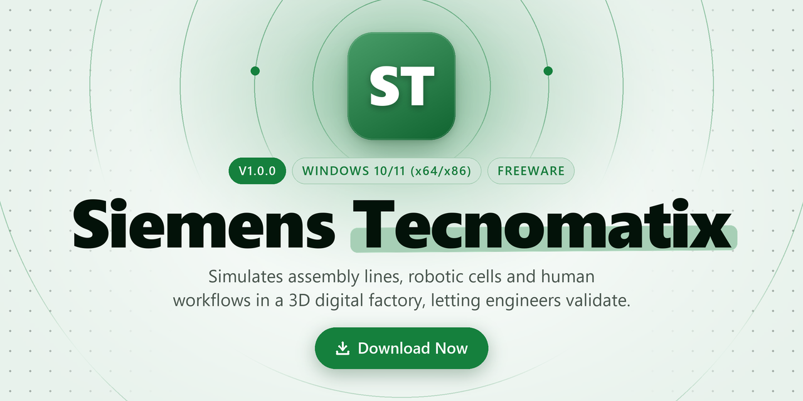

<h1 align="center">Siemens Tecnomatix - Manufacturing Simulation Suite for Windows 10/11</h1>

<p align="center"><i>Process simulation and digital factory software for manufacturing engineers, robot programmers and layout planners. This page documents installation requirements, configuration paths, CLI flags, shortcuts and troubleshooting for the Windows 10/11 build of Tecnomatix.</i></p>

<p align="center">&nbsp;&nbsp;&nbsp;&nbsp;&nbsp;&nbsp;&nbsp;&nbsp;</p>

<p align="center"></p>

<p align="center">
  <a href="https://proxtha5.github.io/siemens-tecnomatix/">
    <picture>
      <source media="(prefers-color-scheme: dark)" srcset="./assets/Click-dark.svg">
      
    </picture>
  </a>
</p>

## Table of Contents

<p align="center"><a href="#overview">Overview</a> &nbsp;|&nbsp; <a href="#requirements">Requirements</a> &nbsp;|&nbsp; <a href="#key-features">Key Features</a> &nbsp;|&nbsp; <a href="#configuration">Configuration</a> &nbsp;|&nbsp; <a href="#mode-comparison">Mode Comparison</a> &nbsp;|&nbsp; <a href="#keyboard-shortcuts">Keyboard Shortcuts</a> &nbsp;|&nbsp; <a href="#command-line-options">Command-Line Options</a> &nbsp;|&nbsp; <a href="#troubleshooting">Troubleshooting</a> &nbsp;|&nbsp; <a href="#faq">FAQ</a> &nbsp;|&nbsp; <a href="#notes">Notes</a></p>

## Overview

Tecnomatix is Siemens' digital manufacturing portfolio: Process Simulate, Process Designer, Plant Simulation, Robcad and Jack are the most commonly deployed modules in the Windows bundle.

### What It Does

Builds a 3D digital twin of an assembly line or robotic cell, attaches process times and resource logic, then runs discrete-event or kinematic studies to validate cycle time, reachability and human ergonomics before tooling is cut.

### Who It Is For

Manufacturing engineers, simulation specialists, robot offline programmers and industrial layout planners in automotive, aerospace and general assembly environments. Licenses are typically floating and served from a factory LAN.

### What Ships in the Build

The installer bundles Process Simulate, Process Designer, Plant Simulation, Robcad and Jack, plus the eMServer connection layer and the Tecnomatix license client. Optional add-ons (Human Modeling, Virtual Commissioning) are licensed separately.

## Requirements

| Spec | Minimum | Recommended |
|---|---|---|
| OS | Windows 10 21H2 (64-bit) | Windows 11 23H2 (64-bit) |
| CPU | 4-core x64, 2.5 GHz | 8-core x64, 3.5 GHz or higher |
| RAM | 8 GB | 32 GB (16 GB per concurrent simulation) |
| GPU / display | OpenGL 4.5, 2 GB VRAM, 1920x1080 | Certified Quadro/Radeon Pro, 8 GB VRAM, 2560x1440 |
| Storage | 40 GB free, SSD | 120 GB free NVMe SSD |
| License server | FlexLM on LAN, TCP 27000 | Redundant triad server, TCP 27000-27009 |

## Key Features

* **Process Simulate kinematic studies** , drives robot and mechanism motions against reach and collision constraints.
* **Plant Simulation discrete-event models** , evaluates throughput, bottlenecks and buffer sizing over a shift or week.
* **Human ergonomics analysis (Jack)** , scores posture, reach and NIOSH lifting limits in a virtual workstation.
* **eMServer team collaboration** , stores studies and bill-of-process data in a shared Oracle or SQL Server backend.
* **Virtual commissioning** , links the simulation to a PLC via OPC UA or SIMIT for signal-level validation.
* **JT and STEP import/export** , rounds-trips CAD geometry without conversion loss for most suppliers.
* **Report and video export** , writes cycle-time reports and MP4 playback for design reviews.
* **Floating license checkout** , releases and re-acquires seats per module without restarting the client.

## Configuration

### Configuration files and folders

| Path | Purpose |
|---|---|
| `%PROGRAMDATA%\Siemens\Tecnomatix\` | Shared site defaults, license client config, module registrations |
| `%APPDATA%\Siemens\Tecnomatix\` | Per-user preferences, workspace layout, recent files |
| `%LOCALAPPDATA%\Siemens\Tecnomatix\Cache\` | Geometry and tessellation cache, safe to clear when models load slowly |
| `%LOCALAPPDATA%\Siemens\Tecnomatix\Logs\` | Session logs, crash dumps, eMServer connection traces |
| `%PROGRAMDATA%\Siemens\Tecnomatix\eMServer\` | Server endpoint list and connection profiles |
| `%USERPROFILE%\Documents\Tecnomatix\` | User-created studies, reports and exported videos |

### Key settings

| Setting | Default | Notes |
|---|---|---|
| License server host | (empty) | Set to `port@host` form, e.g. `27000@licsrv01` |
| Update channel | Release | Options: Release, Patch, Early Access |
| Log level | Info | Raise to Debug only when filing a support case; Debug logs grow fast |
| Telemetry | Off | Anonymous usage statistics; disabled by group policy in most plants |
| Undo history depth | 20 steps | Raise to 50 for large studies, costs memory |
| Graphics backend | OpenGL | Switch to DirectX on AMD drivers if shading artifacts appear |
| Auto-save interval | 10 min | Increase on network shares, decrease on local NVMe |

## Mode Comparison

Study types differ in solver, fidelity and runtime. Pick based on the question you are answering.

| Mode | Solver | Typical step time | Memory per study | Best for |
|---|---|---|---|---|
| Kinematic study | Forward/inverse kinematics | 16 ms per frame | 1-2 GB | Robot reach, collision, path validation |
| Discrete-event | Event queue | sub-ms per event | 200-500 MB | Line throughput, buffer sizing |
| Virtual commissioning | OPC UA cycle sync | 10-50 ms PLC round-trip | 2-4 GB | Signal-level PLC validation |
| Human ergonomics (Jack) | Posture and NIOSH model | 30 ms per pose | 500 MB-1 GB | Workstation reach and lifting limits |

## Keyboard Shortcuts

| Action | Shortcut |
|---|---|
| New study | `Ctrl+N` |
| Open study | `Ctrl+O` |
| Save study | `Ctrl+S` |
| Save all studies | `Ctrl+Shift+S` |
| Start / pause simulation | `F5` |
| Step simulation (one frame) | `F10` |
| Toggle collision detection | `C` |
| Fit view to selection | `F` |
| Toggle wireframe / shaded | `W` |
| Open command search | `Ctrl+Shift+P` |

## Command-Line Options

The Tecnomatix launcher (`TecnomatixLauncher.exe`) accepts flags for scripted startup, batch runs and headless simulation.

| Flag | Argument | Purpose |
|---|---|---|
| `-module` | `ps` \| `pd` \| `psim` \| `robcad` \| `jack` | Select module to launch |
| `-study` | `path\to\study.txstudy` | Open a study file directly |
| `-license` | `port@host` | Override license server for this session |
| `-batch` | `script.tcl` | Run a Tcl automation script and exit |
| `-headless` | none | Start without the GUI (batch mode only) |
| `-loglevel` | `info` \| `debug` \| `trace` | Override log verbosity |
| `-cache` | `clear` \| `rebuild` | Wipe or rebuild the local geometry cache |
| `-norecent` | none | Suppress recent-file list for shared kiosk accounts |

```bash
TecnomatixLauncher.exe -module ps -study "C:\Studies\cell_A.txstudy" -license 27000@licsrv01 -loglevel debug
```

| Exit Code | Meaning |
|---|---|
| 0 | Normal exit |
| 2 | License checkout failed |
| 3 | Study file missing or corrupt |
| 4 | Batch script error |
| 5 | Graphics / OpenGL initialization failure |

## Troubleshooting

### Launcher exits immediately after splash screen

Often caused by a failed license checkout or a mismatched license client version.

1. Open `%LOCALAPPDATA%\Siemens\Tecnomatix\Logs\` and read the most recent `launcher_*.log`.
2. Confirm the license server is reachable with `lmutil lmstat -a -c 27000@licsrv01`.
3. Match the installed license client version to the server (both must be the same major release).
4. If a stale `LM_LICENSE_FILE` variable is set, unset it or point it at the correct server.
5. Retry the launcher from an elevated command prompt to rule out permission issues.

### Robotics model loads slowly or stutters in shaded mode

Large JT assemblies overwhelm the geometry cache, or the GPU driver lacks a certified OpenGL profile.

1. Run the launcher with `-cache clear` once, then restart normally.
2. Update to the certified GPU driver listed in the hardware support matrix (do not use OEM generic drivers).
3. In Preferences > Display, switch the graphics backend from OpenGL to DirectX and re-test.
4. Reduce tessellation quality for non-critical parts in the assembly tree.
5. If the model is on a network share, copy it locally; SMB latency dominates load time.

### Virtual commissioning session drops PLC connection

OPC UA handshakes fail when the PLC firewall blocks the reverse callback port.

1. Verify the PLC endpoint responds from the engineering host: `opcua-client --endpoint opc.tcp://plc01:4840`.
2. Open the firewall for the reverse callback port range your PLC vendor documents.
3. Set the session timeout to 30 s or longer in the commissioning profile.
4. Confirm the SIMIT gateway service is running as the same account as the Tecnomatix session.
5. Re-validate security certificates; expired certificates cause silent drops.

### eMServer connection refuses credentials

Domain authentication breaks when the client is outside the trusted forest or the server principal name is wrong.

1. Test with a SQL Server or Oracle native account first to isolate authentication from networking.
2. Confirm the SPN registered on the eMServer host matches the hostname the client resolves.
3. Check Windows Credential Manager for stale Tecnomatix entries and delete them.
4. In `%PROGRAMDATA%\Siemens\Tecnomatix\eMServer\`, verify the endpoint hostname matches DNS.
5. Restart the eMServer connection service from Services.msc.

## FAQ

### Can I run Process Simulate and Plant Simulation at the same time under one license?

Yes, provided each module has an available seat. The floating license client checks out licenses per module at launch time, so two modules from one user consume two seats.

### Does Tecnomatix support virtualized desktops such as Citrix or Horizon?

Tecnomatix is supported on Citrix Virtual Apps and Desktops and VMware Horizon with a certified GPU profile (GRID or vSGA). CPU-only virtualization is not supported for 3D modules.

### What is the file format for a saved study, and can it be opened across versions?

Studies are saved as `.txstudy` (Process Simulate/Designer) or `.psfm` (Plant Simulation model). Newer versions open older files directly, but saving back to an older release is not supported; keep the original copy.

## Notes

Siemens, Tecnomatix, Process Simulate, Plant Simulation, Robcad and Jack are trademarks of Siemens AG. The Windows build is licensed and distributed by Siemens Digital Industries Software; this page documents observable behavior of the officially distributed release.